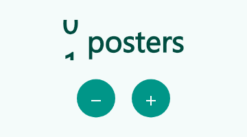

# animated_count



Tiny Flutter widgets that count a number up or down to its new value: `AnimatedCount` for integers, `AnimatedDecimal` for decimals and currencies, and `RollingCount` for odometer-style rolling digits (shown above, three looks).

It renders **one plain `Text`**, so font scaling, line wrapping, baseline alignment and
screen readers behave like for any other text. No custom painting, no extra dependencies.

```dart
AnimatedCount(
  value: posterCount,
  suffix: posterCount == 1 ? ' poster' : ' posters',
  style: const TextStyle(fontSize: 34, fontWeight: FontWeight.w800),
)
```

## Features

- **int, double and currency**: `AnimatedCount` for integers, `AnimatedDecimal` for decimals, and a `format` callback for thousands separators, percentages or any currency.
- **Your own curve and duration**: `curve` (default `Curves.easeOutCubic`) and `duration` (default 600 ms) on both widgets.
- Remember the last shown number with `initialValue`, so a re-opened screen counts only when something changed.

A runnable demo lives in [`example/`](example).

## Behavior

- The first frame shows `value` immediately. Only later changes animate (up **and** down).
- `countFromZero: true` additionally counts up from 0 when the widget first appears.
- Screen readers always read the final text (`prefix + number + suffix`), never the in-between numbers.
- If the system disables animations, the number jumps straight to the target.
- The animation ends exactly on `value`, with no stale digits when the number gets shorter.

## Options

| Parameter | Default | Purpose |
|---|---|---|
| `value` | required | The number to show. |
| `prefix` / `suffix` | `''` | Text before / after the number, part of the same `Text`. |
| `style`, `textAlign` | `null` | Passed to the `Text`. |
| `countFromZero` | `false` | Count up from 0 on first appearance. |
| `initialValue` | `null` | Start the first count from this number (wins over `countFromZero`). |
| `duration` | 600 ms | Length of the animation. |
| `curve` | `Curves.easeOutCubic` | Easing. |
| `format` | `int.toString` | Formats every shown number, e.g. to add thousands separators. |

### Thousands separators

```dart
AnimatedCount(
  value: 1234567,
  format: (n) => NumberFormat.decimalPattern('en_US').format(n), // package:intl
)
```

## Decimals and currencies

```dart
AnimatedDecimal(
  value: total,                       // a double
  duration: const Duration(seconds: 1),
  curve: Curves.easeInOut,
  format: (v) => NumberFormat.currency(locale: 'en_US', symbol: r'$').format(v), // package:intl
)
```

Without `format`, the number is shown with `fractionDigits` decimals (default 2).
`prefix`, `suffix`, `style`, `textAlign`, `countFromZero` and `initialValue` work like on
`AnimatedCount`.

## Remember the last number

By default the first frame shows `value` right away. If you want the number to count
only when it actually changed since the last visit, keep the last shown number yourself
and pass it as `initialValue`:

```dart
final last = prefs.getInt('posterCount'); // null on the very first visit
prefs.setInt('posterCount', posterCount); // remember it for next time

AnimatedCount(
  value: posterCount,
  initialValue: last, // null: no animation (or 0 with countFromZero)
)
```

If `initialValue` equals `value`, nothing is animated. It is only used on the first
appearance; later changes of `value` count from the number currently shown.

## Rolling digits

`RollingCount` shows every digit as its own wheel, like an odometer. Wheels roll through the
digits in between (up when the number grows, down when it shrinks), start one after another
from the right and settle with a small bounce. New digits slide in, vanished ones slide out.

```dart
RollingCount(
  value: posterCount,
  suffix: posterCount == 1 ? ' poster' : ' posters',
  style: const TextStyle(fontSize: 34, fontWeight: FontWeight.w800),
)
```

Three looks, set with `roll`:

| `RollStyle` | Look |
|---|---|
| `odometer` (default) | Flat wheels rolling through the digits in between, started one after another from the right. |
| `drum` | The same, but digits sit on a cylinder: they tilt away with perspective and fade towards the edge. |
| `slot` | Slot machine: every wheel spins one extra turn, all at once, then they stop one after another from the left. Use about 1 s `duration`. |

More knobs: `direction` (`byChange` by default, or always `up` / `down`), `stagger` (delay between
wheels, 40 ms), and `upColor` / `downColor` to tint the text while it rolls, for example green for
more and red for fewer.

```dart
RollingCount(
  value: score,
  roll: RollStyle.slot,
  duration: const Duration(seconds: 1),
  upColor: Colors.green,
  downColor: Colors.red,
)
```

It takes the same parameters as `AnimatedCount` (`prefix`, `suffix`, `style`, `format`,
`duration`, `curve`, `countFromZero`, `initialValue`); the defaults are 700 ms and
`Curves.easeOutBack`. Separators from `format` stay plain text, screen readers read the final
text, and the number jumps if the system disables animations.

## Which one?

Rolling digits need a custom layout (one fixed-width cell per digit), so `RollingCount` is not a
single `Text`: it does not wrap and ignores `textAlign`. Prefer `AnimatedCount` or
`AnimatedDecimal` when the number sits inside running text, or when you need decimals.

## License

MIT
